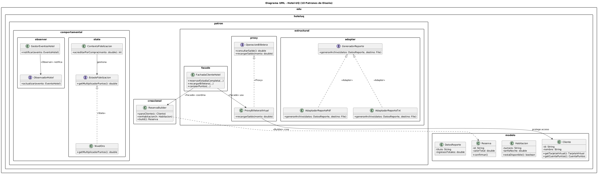

# Hotel-UQ 

---

## Integrantes

### Alejandra Ibarra Ortiz
### Jose Alberto Hernández León

---

##  Características Principales
* **Módulo Administrativo:** Gestión de habitaciones, servicios adicionales, promociones, control de reservas y generación de reportes operativos en tiempo real.
* **Módulo de Clientes:** Panel integral para cotización, reservas en línea, gestión de tarjeta virtual protegida y programa de puntos de fidelización.
* **Exportación Avanzada:** Generación de reportes ejecutivos en formato **TXT** y **PDF** estructurado.

---

##  Mapa de Patrones de Diseño 

El proyecto implementa exactamente los patrones requeridos para resolver problemas específicos del dominio:

###  Creacionales 
1. **Singleton:** Garantiza una única instancia centralizada para los servicios de negocio y repositorios en memoria (`ServicioReservas`, `ServicioHabitaciones`, etc.).
- Ruta: edu.hoteluq.servicio.* 
- Problema que resuelve: Garantiza que los servicios de negocio y repositorios de datos mantengan una única instancia
  en memoria durante toda la ejecución de la aplicación JavaFX, centralizando el estado global del hotel.
- Dónde se utiliza: En cada controlador y fachada del sistema mediante llamadas estáticas como ServicioReservas.getInstancia().


2. **Factory Method:** Instanciación polimórfica de los distintos tipos de habitaciones (`HabitacionEstandar`, `Suite`, etc.).
- Ruta: edu.hoteluq.patron.creacional.factory (o paquete de modelo de habitaciones)
- Problema que resuelve: Evita el uso masivo de condicionales (switch/if) al instanciar polimórficamente los diferentes tipos 
  de habitaciones (HabitacionEstandar, Suite, HabitacionDeluxe), permitiendo agregar nuevos tipos de habitaciones sin modificar el código cliente.
- Dónde se utiliza: Al cargar el catálogo inicial de habitaciones y al seleccionarlas desde el panel administrativo.


3. **Builder:** Construcción paso a paso y validación de la entidad `Reserva` evitando constructores telescópicos.
- Ruta: edu.hoteluq.patron.creacional.builder.ReservaBuilder
- Problema que resuelve: Resuelve el problema del "constructor telescópico" cuando una entidad compleja como Reserva
  requiere múltiples parámetros opcionales y obligatorios (cliente, habitación, fechas, servicios adicionales y promociones)
  validando su consistencia paso a paso.
- Dónde se utiliza: En ServicioReservas.crearYConfirmarReserva(...) antes de procesar el pago.

### Estructurales
4. **Decorator:** Adición dinámica de costos y descripciones de `Servicio` adicional sobre el costo base de la habitación.
- Ruta: edu.hoteluq.patron.estructural.decorator (CostoReserva, ReservaBaseDecorator, ServicioDecorator)
- Problema que resuelve: Permite agregar de forma dinámica y combinada múltiples servicios adicionales (desayuno, spa, parqueadero) sobre el 
  costo base de la reserva sin alterar la clase base Habitacion ni crear subclases.
- Dónde se utiliza: En el método cotizarReserva(...) para calcular en tiempo real los subtotales con extras seleccionados.


5. **Adapter:** Adaptación del modelo interno de `DatosReporte` hacia motores de salida externos (`AdaptadorReporteTxt` y `AdaptadorReportePdf`).
- Ruta: edu.hoteluq.patron.estructural.adapter (GeneradorReporte, AdaptadorReporteTxt, AdaptadorReportePdf, MotorDocumentoPdf)
- Problema que resuelve: Permite que la capa de negocio (ServicioReportes) exporte las métricas del hotel a formatos externos incompatibles con el 
  dominio interno (como la estructura binaria de un documento PDF 1.4 o archivos de texto plano) sin acoplarse a librerías de bajo nivel.
- Dónde se utiliza: En ControladorGestionReportes al hacer clic en "Generar y Guardar Reporte".


6. **Proxy:** Seguridad, validación de estado activo y auditoría de movimientos financieros en la `ProxyBilleteraVirtual`.
- Ruta: edu.hoteluq.patron.estructural.proxy (OperacionBilletera, ProxyBilleteraVirtual, BilleteraVirtualReal)
- Problema que resuelve: Protege el acceso directo a la TarjetaVirtual del cliente aplicando controles de seguridad (validar que la tarjeta esté activa,
  verificar topes mínimos y máximos de recarga) y registrando una pista de auditoría de movimientos sin modificar el modelo original.
- Dónde se utiliza: En el panel del cliente (ControladorMenuCliente) cada vez que se intenta recargar saldo o consultar la billetera.


7. **Facade:** Orquestación unificada en `FachadaClienteHotel` para simplificar la interacción entre controladores y los subsistemas del hotel.
- Ruta: edu.hoteluq.patron.estructural.facade.FachadaClienteHotel
- Problema que resuelve: Oculta la alta complejidad y el acoplamiento de coordinar múltiples subsistemas internos (ServicioHabitaciones, ServicioReservas, ProxyBilleteraVirtual, ServicioFidelizacion, GestorEventosHotel),
  exponiendo una interfaz unificada y limpia para la capa gráfica.
- Dónde se utiliza: En ControladorMenuCliente para simplificar la lógica de cotización, reservas y gestión de cuenta en una sola clase fachada.

### Comportamentales
8. **Strategy:** Algoritmos de descuento intercambiables (`EstrategiaDescuento`) evaluados sobre las promociones vigentes.
- Ruta: edu.hoteluq.patron.comportamental.strategy (EstrategiaDescuento, etc.)
- Problema que resuelve: Encapsula diferentes algoritmos de cálculo de descuentos promocionales (ej. descuentos por temporada, 
  por fidelización o por volumen) permitiendo intercambiarlos en tiempo de ejecución según las reglas vigentes de la Promocion.
- Dónde se utiliza: En ServicioReservas.cotizarReserva(...) al evaluar si una promoción aplica sobre el subtotal decorado.


9. **State:** Gestión del nivel de membresía del cliente (`NivelBronce`, `NivelPlata`, `NivelOro`) con reglas automáticas de acumulación y bonos de canje.
- Ruta: edu.hoteluq.patron.comportamental.state (EstadoFidelizacion, NivelBronce, NivelPlata, NivelOro, ContextoFidelizacion)
- Problema que resuelve: Elimina estructuras condicionales complejas basadas en el nivel del cliente, delegando el comportamiento específico de cada membresía 
  (multiplicador de puntos y bonos de canje) a clases de estado independientes que gestionan sus propias transiciones automáticas.
- Dónde se utiliza: En el programa de puntos de fidelización cuando el cliente acumula compras o canjea saldo en su tarjeta virtual.


10. **Observer:** Desacoplamiento de eventos de negocio (`GestorEventosHotel`) para acreditar puntos automáticamente y registrar notificaciones en tiempo real.
- Ruta: edu.hoteluq.patron.comportamental.observer (ObservadorHotel, GestorEventosHotel, ObservadorHistorialNotificaciones, ServicioFidelizacion)
- Problema que resuelve: Desacopla la emisión de eventos del hotel (como confirmar una reserva o recargar la billetera) de las acciones secundarias que deben dispararse, 
  permitiendo notificar en tiempo real al historial de notificaciones del cliente y acreditar puntos de manera automática sin acoplar los servicios.
- Dónde se utiliza: En FachadaClienteHotel cuando se confirma una reserva exitosa, disparando la notificación y la acumulación de puntos de forma transparente.

---

## Estructura del Proyecto
```text
src/main/java/edu/hoteluq/
├── controlador/       # Controladores JavaFX (Admin, Cliente, Reportes, Login)
├── modelo/            # Entidades de Dominio (Habitacion, Reserva, Cliente, etc.)
├── patron/            # Implementación organizada de los 10 Patrones de Diseño
│   ├── creacional/    # (Singleton, Factory, Builder)
│   ├── estructural/   # (Decorator, Adapter, Proxy, Facade)
│   └── comportamental/# (Strategy, State, Observer)
└── servicio/          # Capa de Lógica de Negocio y Reglas del Dominio

## Diagrama UML de Arquitectura


